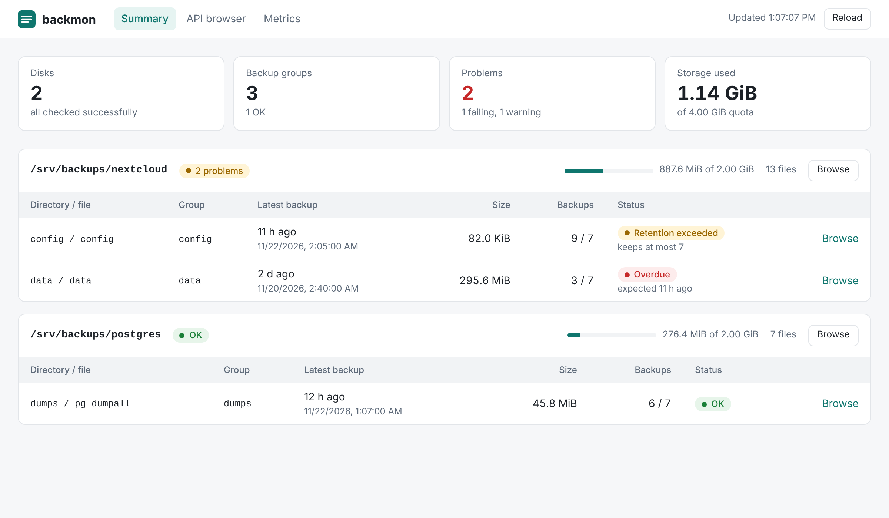
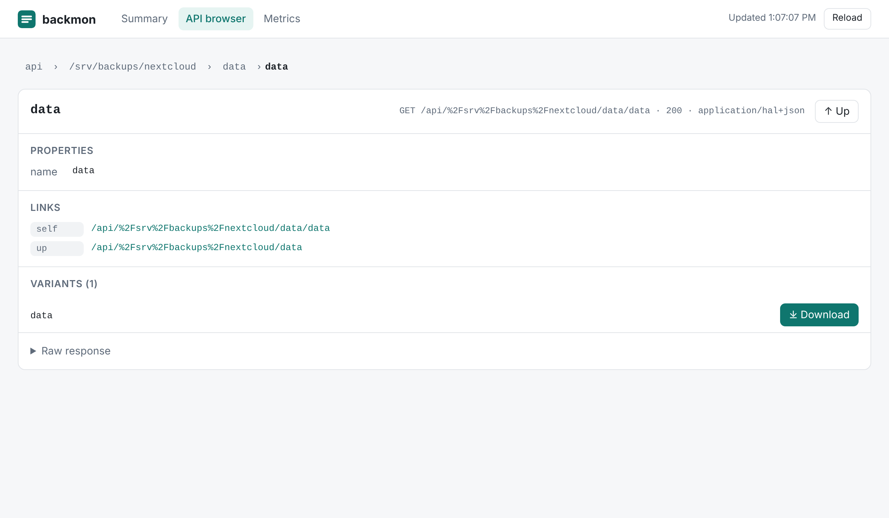

# Web UI

*backmon* comes with a small web UI. Open *backmon* in a browser, e.g. `http://localhost:8000/`, to see the state of
all monitored backups at a glance and to browse the [API](30-api.md).

:::info

The web UI is available in *backmon* 6.2.0 and later. Before, `/` always redirected to `/api`.

:::

Only browsers get the web UI on `/`: requests whose `Accept` header contains `text/html`. All other clients, e.g.
`curl` or scripts, are still redirected to `/api`. `/api` and `/metrics` are not changed by the web UI.

## Summary

The summary shows

- the number of disks, backup groups and problems, and the storage used by all disks,
- for each disk its status, the used storage compared to its `quota` and the number of files, and
- for each group of backup files its latest backup, its size and the number of backups.

| Status               | Meaning                                                                                          |
|----------------------|--------------------------------------------------------------------------------------------------|
| OK                   | The latest backup has been created on schedule.                                                  |
| Overdue              | The latest backup is older than the time the [`schedule`](20-backup-definition/10-overview.md) expects. |
| Retention exceeded   | There are more backups than `retention-count` allows; check [purging](20-backup-definition/30-purging.md). |
| No backups           | No backup file has been found for the group.                                                     |
| Check failed (disk)  | The backup definitions of the disk are missing or invalid, or its files could not be listed. The log of *backmon* has the details. |

The summary is built from the [metrics](metrics.md) and refreshed every 30 seconds, so it shows the same state as
Prometheus. The statuses correspond to the usual alerting rules, e.g. *Overdue* to
`backmon_backup_latest_file_created_at_timestamp_seconds < backmon_backup_latest_file_creation_expected_at_timestamp_seconds`.

## API browser

The API browser follows the links of the [HAL documents](30-api.md#hypermedia) of the API: start at the list of disks
and open a disk, a directory and a file. For each resource it shows its properties, links, embedded resources and the
raw response.

The variants of a file have a *Download* button for their latest backup if downloads are enabled with
`downloads.enabled` in the [configuration](10-backmon-configuration/01-overview.md#available-configuration-keys).

## Authentication

The web UI itself has no endpoints and contains no data: the summary reads `/metrics`, the API browser reads `/api`.
If `http.basic_auth` is configured, the browser asks for the credentials as soon as the API browser is opened and
reuses them for downloads. The summary works without credentials, like `/metrics`.

## Running behind a reverse proxy

If a reverse proxy serves *backmon* below a path prefix, the web UI uses the prefix of the `X-Forwarded-Prefix`
header like the API; see [Running behind a reverse proxy](30-api.md#running-behind-a-reverse-proxy).
